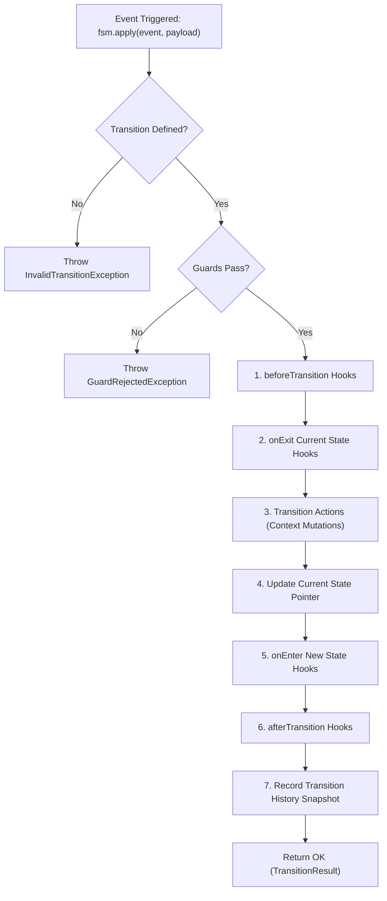
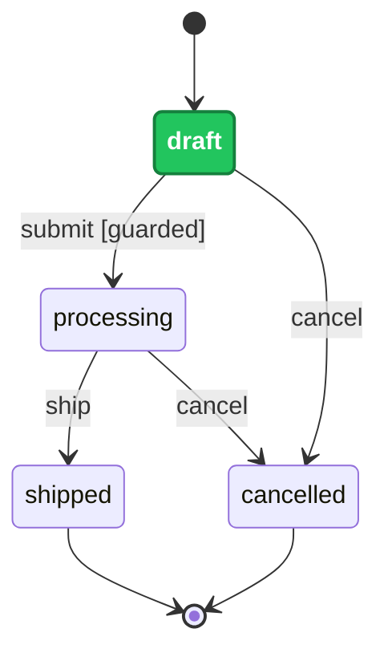

<div align="center">

# ⚡ StateWire

**Zero-dependency, high-performance Finite State Machine (FSM), guarded transition lifecycle, state graph validation & visual export engine for PHP 8.2+**

[](https://github.com/mrhamidrezam/statewire/actions/workflows/ci.yml)
[](https://php.net)
[](LICENSE)
[](composer.json)
[](https://www.php-fig.org/psr/psr-12/)

</div>

---

## 🚀 Overview

State transitions are the backbone of resilient backend systems—governing order lifecycles, payment workflows, background job retries, document approvals, and subscription billing. Yet, developers often resort to fragile conditional blocks (`switch-case`), unstructured database flags, or bloated frameworks requiring dozens of external dependencies.

**StateWire** brings architectural elegance and type safety to PHP state management:
* **Zero Dependencies**: Lightweight, self-contained, and ready out of the box.
* **Strict Guard Conditions**: Block invalid state changes with custom rejection reasons.
* **Lifecycle Hooks**: Predictable hook sequence (`before`, `onExit`, `action`, `onEnter`, `after`).
* **Graph Topology Auditor**: Detect unreachable states, dead ends, and ambiguous transitions at compile time or via CLI.
* **PHP 8.2+ Enum Native**: Seamlessly works with strings or native `BackedEnum` values.
* **Automated Visual Exporters**: Export live graphs to **Mermaid (`stateDiagram-v2`)**, **PlantUML**, and **Graphviz DOT**.
* **Built-in CLI**: Inspect, validate, simulate, and export state machines directly from the terminal.

---

## 🏗️ Architecture & Transition Lifecycle

Every transition in StateWire follows a deterministic, guarded execution pipeline:



---

## 📦 Installation

```bash
composer require mrhamidrezam/statewire
```

Or clone directly and use the bundled zero-dependency autoloader:
```php
require_once __DIR__ . '/src/autoload.php';
```

---

## 💡 Quick Start

```php
use StateWire\StateMachine;
use StateWire\Guard;
use StateWire\Context;

// 1. Define your finite state machine
$machine = StateMachine::builder('OrderPipeline')
    ->initial('draft')
    ->state('processing')
    ->finalState('shipped')
    ->finalState('cancelled')
    ->transition('draft', 'processing', 'submit', [
        Guard::create(fn(Context $ctx) => count($ctx->get('items', [])) > 0, 'Cart is empty')
    ])
    ->transition('processing', 'shipped', 'ship')
    ->transition('*', 'cancelled', 'cancel')
    ->onEnter('shipped', function (Context $ctx) {
        echo "Alert: Order #{$ctx->get('order_id')} has been shipped!\n";
    })
    ->build([
        'order_id' => 1042,
        'items' => ['Mechanical Keyboard']
    ]);

// 2. Query available events and states
echo $machine->getState(); // "draft"
var_dump($machine->can('submit')); // true

// 3. Apply state transitions
$machine->apply('submit');
echo $machine->getState(); // "processing"

$machine->apply('ship');
echo $machine->getState(); // "shipped"
var_dump($machine->isFinal()); // true
```

---

## 🛡️ Guard Conditions with Custom Reasons

Guards evaluate the machine's current `Context` and runtime transition payload:

```php
$machine = StateMachine::builder('BankAtm')
    ->initial('card_inserted')
    ->state('authenticated')
    ->transition('card_inserted', 'authenticated', 'enter_pin', [
        Guard::create(
            fn(Context $ctx, array $payload) => $payload['pin'] === $ctx->get('pin'),
            'Invalid security PIN code'
        )
    ])
    ->build(['pin' => '9842']);

// Safe transition check
$result = $machine->transition('enter_pin', ['pin' => '0000']);
if (!$result->successful) {
    echo $result->failureReason; // "Invalid security PIN code"
}
```

---

## 🏷️ Native PHP 8.2+ BackedEnum Support

Eliminate string typos using native PHP enums:

```php
enum OrderState: string {
    case Draft = 'draft';
    case Paid = 'paid';
    case Shipped = 'shipped';
}

enum OrderEvent: string {
    case Pay = 'pay';
    case Ship = 'ship';
}

$machine = StateMachine::builder('EnumFsm')
    ->initial(OrderState::Draft->value)
    ->state(OrderState::Paid->value)
    ->finalState(OrderState::Shipped->value)
    ->transition(OrderState::Draft->value, OrderState::Paid->value, OrderEvent::Pay->value)
    ->transition(OrderState::Paid->value, OrderState::Shipped->value, OrderEvent::Ship->value)
    ->build();

$machine->apply(OrderEvent::Pay);
$machine->is(OrderState::Paid); // true
```

---

## 🔍 Graph Topology Auditor

Detect architectural flaws before deploying to production:

```php
$audit = $machine->validate();

if (!$audit->isValid()) {
    print_r($audit->unreachableStates);    // States that cannot be reached from initial
    print_r($audit->deadEndStates);        // Non-final states with 0 exits
    print_r($audit->warnings);             // Ambiguous duplicate transitions
}
```

---

## 📊 Live Visual Exporters

Export your state diagrams dynamically for documentation:

### Mermaid `stateDiagram-v2`
```php
echo $machine->toMermaid();
```


### PlantUML & Graphviz DOT
```php
echo $machine->toPlantUml();
echo $machine->toDot();
```

---

## 💻 Command Line Interface (CLI)

StateWire includes a zero-dependency CLI tool (`bin/statewire`) for terminal workflows:

| Command | Description |
|---|---|
| `statewire inspect <file>` | Inspect state machine topology, states, and events |
| `statewire validate <file>` | Audit graph for unreachable states and dead-ends |
| `statewire mermaid <file>` | Export machine definition to Mermaid `stateDiagram-v2` |
| `statewire plantuml <file>` | Export machine definition to PlantUML format |
| `statewire dot <file>` | Export machine definition to Graphviz DOT format |
| `statewire simulate <file>` | Sequentially simulate events (`--events=submit,pay,ship`) |

```bash
# Validate graph topology
php bin/statewire validate examples/workflow.json

# Step-through simulation
php bin/statewire simulate examples/workflow.json --events=submit,payment_received,ship,deliver
```

---

## 🧪 Testing Suite

StateWire includes an integrated zero-dependency test runner with 100% test pass rate:

```bash
php tests/run.php
```

```text
=== StateWire Test Suite ===

CliTest.php
  ✔ testCliVersion
  ✔ testCliHelp
  ✔ testCliInspect
  ✔ testCliValidate
  ✔ testCliMermaid
  ✔ testCliSimulateSequence

ContextAndHistoryTest.php
  ✔ testContextMethodsAndArrayAccess
  ✔ testTransitionHistoryAuditTrail

ExportersTest.php
  ✔ testMermaidDiagramExport
  ✔ testPlantUmlExport
  ✔ testDotExport

GraphAuditorTest.php
  ✔ testValidGraphPassesAudit
  ✔ testDetectsUnreachableAndDeadEndStates
  ✔ testDuplicateTransitionDetection

GuardTest.php
  ✔ testPassingGuardAllowsTransition
  ✔ testFailingGuardBlocksTransition
  ✔ testMultipleGuardsAllMustPass
  ✔ testGuardEvaluatesTransitionPayload

HookLifecycleTest.php
  ✔ testCompleteLifecycleHookExecutionOrder
  ✔ testActionMutatesContext

SerializationTest.php
  ✔ testJsonSerializationAndDeserialization
  ✔ testFromArrayInstantiation

StateMachineTest.php
  ✔ testInitialStateAndFinalStateDetection
  ✔ testWildcardTransitions
  ✔ testMultiSourceTransitions
  ✔ testCanMethodDetectsAvailableEvents
  ✔ testApplyThrowsOnInvalidTransition
  ✔ testUndefinedInitialStateThrows
  ✔ testPhpBackedEnumSupport

──────────────────────────────────────────────────
OK (29 tests, 116 assertions, 1.554 s)
```

---

## 📄 License

StateWire is open-source software licensed under the [MIT License](LICENSE).
Authored by [Hamidreza Mahdavipanah](https://github.com/mrhamidrezam).
